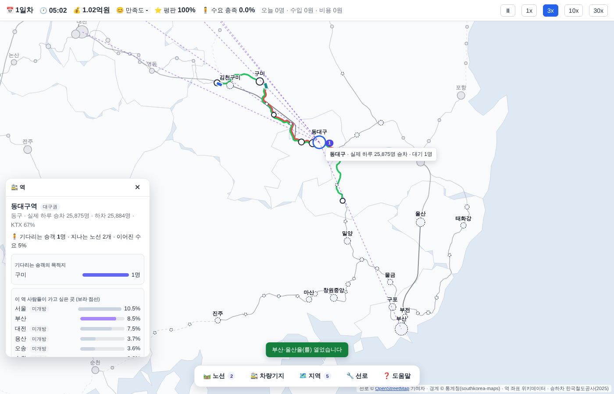

# 전국 철도 경영 (프로토타입)

실제 코레일 역별 승하차 데이터로 만든 철도 회사 경영 게임입니다. 동대구역과 무궁화호 한 대로 시작해 전국으로 노선을 넓힙니다.



## 실행
`train/web/index.html`을 브라우저로 열면 됩니다. 서버는 필요 없고, 진행 상황은 브라우저(localStorage)에 하루 단위로 저장됩니다.

## 게임
- **열차 4종**
  - 🚂 완행열차: 비둘기호 → 통일호 → 무궁화호 (싸고 느림, 모든 선로)
  - 🚆 일반열차: 새마을호 → 누리로 → ITX-새마을 → ITX-마음 (누리로부터 전철화 선로만)
  - 🚈 광역열차: 대경선 같은 지역 통근열차(광역전철 4·6·8량). 전철화 선로만. 광역열차 전용 통근 승객(4~70km, 출퇴근 시간 집중, 배차가 잦을수록 크게 증가)
  - 🚄 고속열차: KTX → KTX-산천 → KTX-이음 → KTX-청룡. 고속선과 전철화된 일반선
- **열차 등급표**: 차량기지 맨 위 📊 버튼. 등급을 올릴수록 최고속도·정원이 오름
  - 속도: 완행 110→130→150 / 일반 150→160→180→200 / 광역 110→130→150 / 고속 280→300→310→330km/h
  - 편성·좌석은 실제 열차 기준(대략). 게임 승객이 실제의 1/5이라 게임 정원 ≈ 실제 정원 ÷ 5. 등급을 올릴수록 정원도 늘어남
    완행 80→86→100명 / 일반 66→106(누리로 중련 8량)→150(ITX-새마을 중련 12량)→156(ITX-마음 중련 12량)
    광역 128→192→256명(입석 포함) / 고속 187(KTX 20량)→190→196→220명(산천·이음·청룡은 중련, 입석 포함)
  - 열차는 선로 속도를 넘지 못함: 일반선 고속화 최대 200, 고속선도 고속화 가능(330까지, 비용 2배)
- **노선**: 정차할 역만 고르면 선로를 따라 길을 찾습니다. 사이의 역은 통과(급행). 그리는 중에 넣은 역을 다시 누르면 빠짐
- **추천 열차 수**: 어제 하루 중 열차가 가장 많이 필요했던 시간대(새벽·출근·낮·퇴근·밤) 기준. 하루 동안 바뀌지 않음(첫날만 오늘 기록으로)
- **시작**: 동대구역 + 경부선 대구권 구간 + 비둘기호 1대(차량기지), 자금 4,500만원. 노선은 직접 만듦
- **회사 레벨(1~15)**: 누적 운임 수입으로 오름. 처음엔 대구권만 열 수 있고, 경북 북부 Lv2(1억) · 경북 동해안·통일호 Lv3(2.5억) · 경남 Lv4(5억) · 부산·울산 Lv5(20억),
  전철화·무궁화호·새마을호 Lv6(50억), 광역 6량·복선화·충북·누리로 Lv7(150억), 대전·충남 Lv8(500억), KTX·ITX-새마을 Lv9(2,000억), 고속선·KTX-산천 Lv10(5,000억),
  수도권·KTX-이음 Lv11(1조), ITX-마음·고속화·강원 Lv12(2.5조), 광역 8량·전북 Lv13(5조), 광주·전남 Lv14(11조), KTX-청룡 Lv15(23조).
  대출 한도에도 레벨 배율(Lv1 ×0.5 ~ Lv15 ×2.3). 이미 연 지역·산 열차는 레벨 기준이 바뀌어도 그대로
- **넓히기**: 🗺️ 지역 열기 → 🔧 선로 구간(노선 × 지역) 사기 → 역 사기 → 노선 만들기
  - 대구권에서 시작(11개 지역). 선로로 이어진 이웃 지역만, 그 지역 레벨이 되면 열 수 있음
  - 역 가격은 실제 승차 인원에 비례(서울역이 가장 비쌈). 노선을 그리다 안 산 역·구간을 누르면 바로 살 수 있음
- **결산**: 달이 끝날 때마다 월 결산표(승객·손익·노선별 손익·투자). 2026년 1월 1일부터 실제 달력으로 진행. 속도 1·3·10·30·100배(⏸ 옆 버튼을 누를 때마다 바뀜, 폰·웹 같음)
- **은행**: 한도 = (3,000만원 + 회사 자산 × 50%) × 신용등급 배율. 이자는 날마다(A 0.2% ~ D 0.7%)
  - 신용등급은 최근 7일 손익(이자 포함)과 만족도로 정함. D면 새로 못 빌림
  - 자금이 마이너스인 채로 3일을 마치면 비싼 열차부터 강제 매각, 그래도 모자라면 파산
- **시간표**: 노선마다 첫차·막차와 시간대별(새벽·출근·낮·퇴근·밤) 배차 간격. 기본은 열차 수에 맞춘 자동, 직접 정하면 필요한 열차 수를 계산.
  승객은 원하는 시각에 가장 가까운 편을 예매하고 출발 10분 전에 역에 옴. 좌석이 다 팔리면 매진 → 다음 편. 열차가 모자라면 결행.
  역 카드에 출발 안내판, 월 결산에 정시율·결행·매진
  - 👥 승객 맞춤 추천: 시간대별 승객 기록으로 가장 붐비는 시간대를 다 태울 간격과 필요한 열차 수를 정하고, 한가한 시간에도 그 열차들을 계속 돌림(자주 다닐수록 손님이 늘어 이익). 승객이 거의 없는 시간대만 간격을 넓힘
- **운임**: 등급을 올리면 km당 운임도 오름(100km: 완행 5,000→5,800→6,600 / 일반 9,000→9,500→10,000→10,600 / 광역 4,000→4,300→4,600 / 고속 14,500→15,000→15,500→16,200원)
- **차량기지**: 배차 안 된 열차를 한꺼번에 팔기(전체 또는 종류별)
- **🔄 열차 수 모두 추천으로**(노선 탭 맨 위): 모든 노선 열차 수를 추천대로. 줄인 열차는 회수해 같은 종류 노선에 먼저 다시 쓰고, 모자라면 삼. 버튼과 확인창에 늘리기·줄이기·구입 대수와 총 가격
- **노선 카드**: ＋ 열차 추가 버튼은 등급 올리기 버튼과 같은 줄
- **환승**: 승객은 한 번까지 갈아탑니다(예: 대경선 → 동대구 → KTX). 요금은 탄 열차마다 냄
- **북한**: 경의선을 도라산까지 늘리고, 도라산–판문–개성–평양으로 이어지는 평부선부터 북한 11개 노선(평의·평라·강원·금강산청년·만포·함북·백두산청년·평남·황해청년·평덕선), 역 81개.
  지역 5개: 개성·황해 Lv12 · 평양·평남 Lv13 · 평북·자강, 강원·함남 Lv14 · 함북·양강 Lv15. 선로는 느림(60~80km/h, 고속화 공사로 올림).
  역 좌표·선로 모양은 OpenStreetMap, 도 경계는 geoBoundaries(WFP·OCHA ROAP, CC BY 3.0 IGO). **승하차 자료가 없어 도시 인구로 추정**(하루 승차 ≈ 인구 × 0.6%, 작은 역 300명)
- **건설 중·계획 노선**(충청권 광역철도, 부전–마산, 남부내륙철도, 대구산업선, 광주–나주): 추후 업데이트 예정
- **선로 개량**: 전철화 · 복선화(시간당 열차 4→16대) · 고속화(+30km/h). 용량을 넘기면 느려짐
- **수요**: 역별 실제 하루 승차 ÷ 5. 목적지는 하차 인원과 거리로 정하고(중력 모델), 아직 안 열린 지역으로 가려는 수요는 놓칩니다. 자동차보다 빠르고 자주 다닐수록 승객이 늘어납니다

## 데이터 다시 만들기
```
python3 train/scripts/build_rail_geom.py <export.geojson>   # OSM 선로 → train/data/rail_geom.json (역 사이 실제 모양·길이)
python3 train/scripts/build_train_data.py                   # → train/web/data.js
node train/scripts/sim_check.js 3 +gyeongnam +busan 동대구,밀양,부산   # 화면 없이 며칠 돌려 보는 밸런스 점검
```
- 선로(노선별 역 순서·전철화·복선·최고속도)는 `build_train_data.py`의 `LINES`에 직접 적었습니다.
- 역 사이 모양과 거리는 OpenStreetMap 실제 선로를 따라 잰 값입니다(271개 구간 중 269개. 대야–익산, 부산–부전만 직선).
  `export.geojson`은 overpass-turbo.eu에서 받은 철도 선로 파일(약 22MB)로, 저장소에는 결과물 `rail_geom.json`만 넣었습니다.
  받는 쿼리는 `build_rail_geom.py` 맨 위에 있습니다.

## 데이터 출처 (`train/data/raw/`)
- 한국철도공사 역별 승하차 현황(2025년 합계), KTX 상하행 역별 승하차(~2023): 공공데이터포털
- 역 좌표: 위키데이터(CC0)
- 선로 모양: © OpenStreetMap 기여자 (ODbL), 2026-11 overpass-turbo 추출
- 시도·시군구 경계: 통계청 2013, [southkorea-maps](https://github.com/southkorea/southkorea-maps)

## 밸런스
`train/web/sim.js` 맨 위 `CFG`에서 열차 가격·정원·속도·요금·운행비, 지역 개방 비용, 선로 용량, 수요 배율을 조정합니다.
